```mermaid
sequenceDiagram
    autonumber
    actor Parent as Parent (WhatsApp)
    participant Gateway as Payment Gateway (ICICI/Razorpay)
    participant ERP_Webhook as Vidyoday ERP (/api/v1/webhooks/payment)
    participant Postgres as PostgreSQL Ledger (RLS)
    participant Tally as Tally Prime Bridge
    participant WhatsAppAPI as WhatsApp Business API

    Parent->>Gateway: Taps UPI link (upi://pay?pa=dpa.trust@icici&am=35700)
    Gateway-->>Parent: Authorization Success & Bank Debit (T+1)
    Gateway->>ERP_Webhook: POST /api/v1/webhooks/payment (HMAC Verified)
    
    rect rgb(20, 30, 50)
    note over ERP_Webhook,Postgres: Atomic Split Calculation (82% Trust : 18% Fleet)
    ERP_Webhook->>Postgres: INSERT INTO ledger_entries (ICICI Trust Debit: ₹29,274)
    ERP_Webhook->>Postgres: INSERT INTO ledger_entries (HDFC Fleet Debit: ₹6,426)
    ERP_Webhook->>Postgres: INSERT INTO ledger_entries (Student Receivable Credit: ₹35,700)
    end

    ERP_Webhook->>Tally: Push Balanced Journal Voucher (ODBC / XML)
    ERP_Webhook->>WhatsAppAPI: Dispatch PDF Receipt via WhatsApp Template
    WhatsAppAPI-->>Parent: "Namaste Shri Alam, Q3 fee receipt RCP-2026-1492 confirmed."
```

```mermaid
sequenceDiagram
    autonumber
    participant BioHardware as Biometric / Face Recognition Hardware
    participant BioWebhook as Vidyoday Ingress (/api/v1/webhooks/biometric)
    participant SubSolver as 7:30 AM Solver Engine
    participant Smartboard as Classroom 8-A Smartboard
    participant TeacherMobile as Substitute Teacher Mobile (Vidyoday App)

    BioHardware->>BioWebhook: POST /api/v1/webhooks/biometric (Punches until 07:45 AM)
    BioWebhook->>SubSolver: Evaluate Staff Roster vs Biometric Pings
    Note over SubSolver: Detected Sunita Verma (Maths) UNANNOUNCED ABSENT
    
    rect rgb(30, 20, 40)
    Note over SubSolver: Rule 1: Subject Match (Maths / Science)<br/>Rule 2: Free in Period 1<br/>Rule 3: Weekly Cap Check (< 3 substitutions/week)
    SubSolver->>SubSolver: Selected Harpreet Singh (0 subs this week vs Priyanka Sen with 2)
    end

    SubSolver->>Smartboard: Webhook Push -> Display Substitute Name & Instructions
    SubSolver->>TeacherMobile: Push Notification -> "You are assigned Class 8-A Period 1 (Maths)"
```

# Vidyoday CBSE ERP: Microservice Architecture & Webhook Specification

This document details the high-scale microservice architecture, asynchronous webhook pipelines, and data synchronization flows designed for Indian K-12 CBSE schools and multi-branch school trusts.

---

## 1. High-Level Architecture Diagram

```
+-----------------------------------------------------------------------------------+
|                                 CLIENT INGRESS LAYER                              |
|                                                                                   |
|  [Next.js 15 Web Portal]         [Flutter Offline Mobile]        [Biometric / GPS] |
|   (Trustees / Principals)          (Classroom Teachers)         (Hardware Gateways) |
+------------------------+-------------------+----------------------------+---------+
                         |                   |                            |
                         v                   v                            v
+-----------------------------------------------------------------------------------+
|                        API GATEWAY & NEXT.JS APP ROUTER                           |
|                        http://localhost:3005/api/v1/                             |
|                                                                                   |
|  - JWT / Tenant RLS Context Validator                                             |
|  - Webhook HMAC-SHA256 Signature Verifier                                         |
|  - Rate Limiter & Idempotency Key Filter                                          |
+------------------------+----------------------------------------------------------+
                         |
      +------------------+------------------+------------------+
      |                                     |                  |
      v                                     v                  v
+---------------+                   +---------------+   +-------------------+
| Fee & Cashflow|                   | Biometric &   |   | Statutory Hub     |
| Split Engine  |                   | Timetable Core|   | (UDISE+, LOC, HPC)|
+-------+-------+                   +-------+-------+   +---------+---------+
        |                                   |                     |
        | Atomic Split                      | Auto-Solve          | Validate
        v                                   v                     v
+-----------------------------------------------------------------------------------+
|                          PERSISTENCE LAYER (PostgreSQL 16)                        |
|                                                                                   |
|  - Multi-Tenant Row Level Security (RLS) keyed on tenant_id & campus_id           |
|  - Immutable Double-Entry Ledger (trg_immutable_ledger)                           |
|  - JSONB dynamic columns for NEP 2020 PARAKH rubrics                              |
+-----------------------------------+-----------------------------------------------+
                                    |
            +-----------------------+-----------------------+
            |                                               |
            v                                               v
+-----------------------+                       +-----------------------+
| Redis 7 & BullMQ      |                       | Outbound Connectors   |
| Asynchronous Workers  |                       | & Statutory Gateways  |
|                       |                       |                       |
| - 360° HPC PDF Render |                       | - WhatsApp Cloud API  |
| - Tally Prime XML Sync|                       | - MoE UDISE+ Batch    |
| - SMS Fallback Queue  |                       | - CBSE Pariksha Sangam|
+-----------------------+                       +-----------------------+
```

---

## 2. Webhook Flow 1: WhatsApp 1-Tap UPI Recovery & Double-Entry Split Settlement

### The Problem Solved
Traditional school ERPs rely on manual clerk entries or single unsegregated gateway settlements that commingle educational trust funds with transport and cafeteria revenues, creating severe audit non-compliance.

### Sequence Flow



---

## 3. Webhook Flow 2: 7:30 AM Biometric Punch & Auto-Substitution Matrix

### The Problem Solved
When teachers call in sick at 7:30 AM, academic coordinators scramble on WhatsApp groups to find replacements. Classes sit unsupervised or the same cooperative teachers are overburdened.

### Sequence Flow



---

## 4. Webhook Flow 3: Offline-First Classroom Attendance Synchronization

### The Problem Solved
Thick concrete walls in Indian school campuses frequently create Wi-Fi dead zones. Vidyoday's Flutter mobile app allows teachers to mark attendance offline in under 15 seconds, storing records locally in SQLite/Drift and syncing automatically upon reconnection.

### Conflict Resolution Strategy: CRDT Last-Write-Wins (LWW)
- Every offline attendance mark has a cryptographically signed client UUID and millisecond UTC timestamp.
- When Wi-Fi resumes, `POST /api/v1/sync/offline-attendance` ingests the batch.
- Server validates that the teacher employee code has authorized class access and commits the records.
- Automatically generates the absence notification queue for parent dispatch after the 1st period.

---

## 5. BullMQ & Redis Worker Queue for NEP 2020 360° HPC Report Cards

### Asynchronous PDF Generation Architecture
Generating 1,840 publication-quality 360° Holistic Progress Cards with high-resolution radar charts, QR verification codes, and official seals takes ~2.4 seconds per card. Doing this synchronously would crash web worker threads.

- **Queue Name:** `queue:cbse-report-card-pdf`
- **Concurrency:** 8 headless Chromium/Puppeteer workers managed via BullMQ.
- **Throughput:** 1,840 student HPC cards rendered, digitally signed, and stored on Cloudflare R2 / S3 in under 4 minutes.
- **Delivery:** Generates pre-signed S3 download URLs and dispatches notifications to parents via WhatsApp and the Vidyoday Parent Portal.
